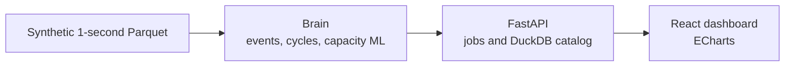
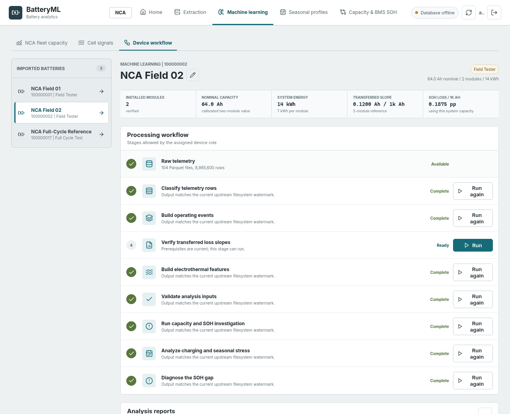
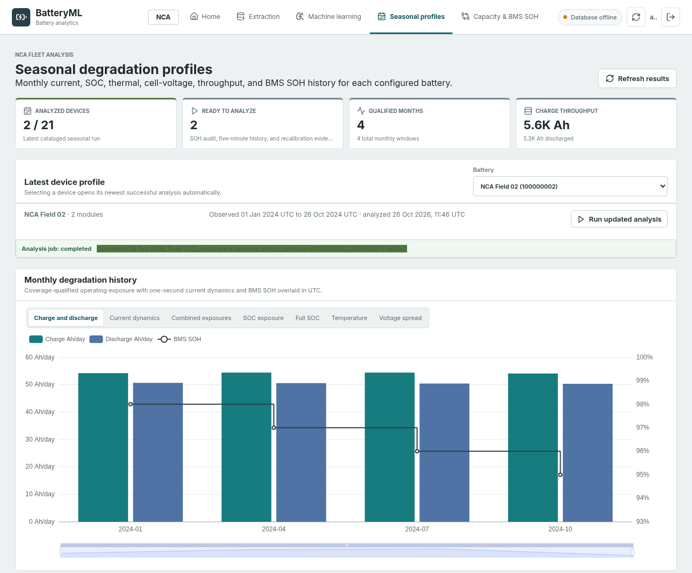
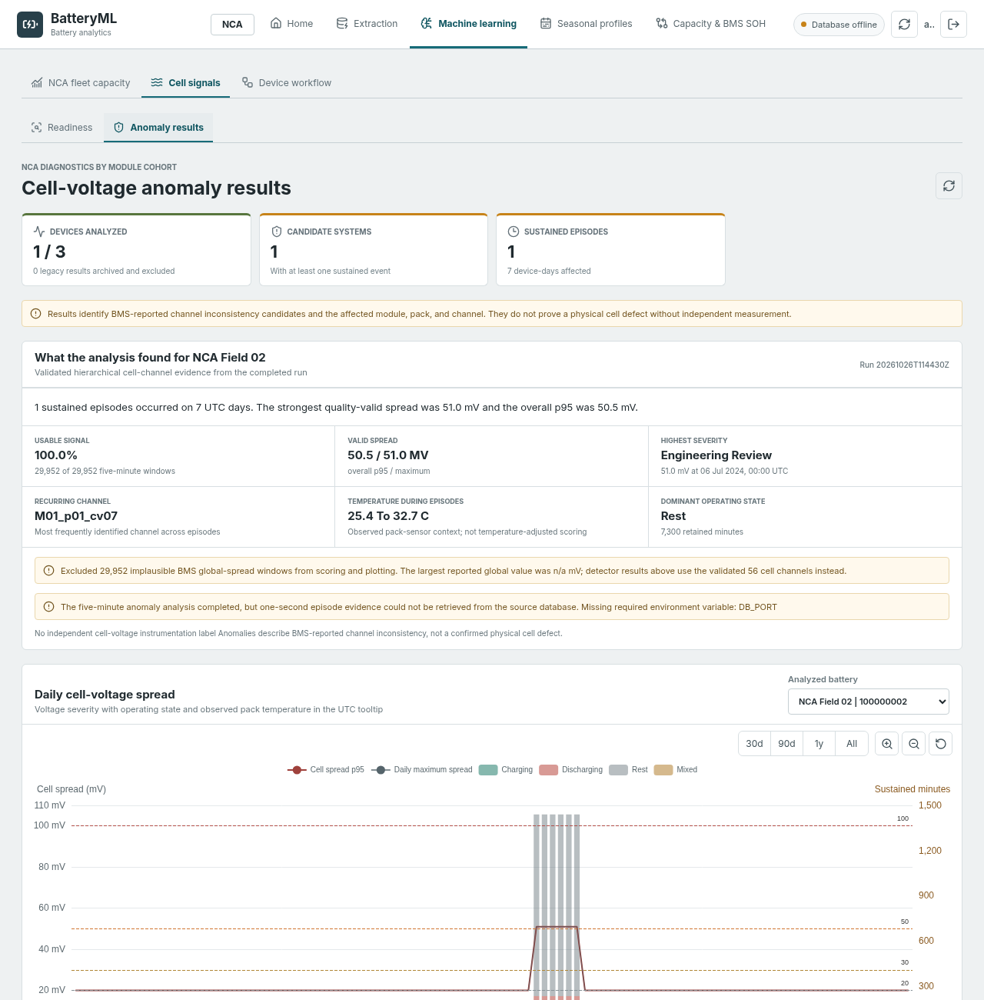
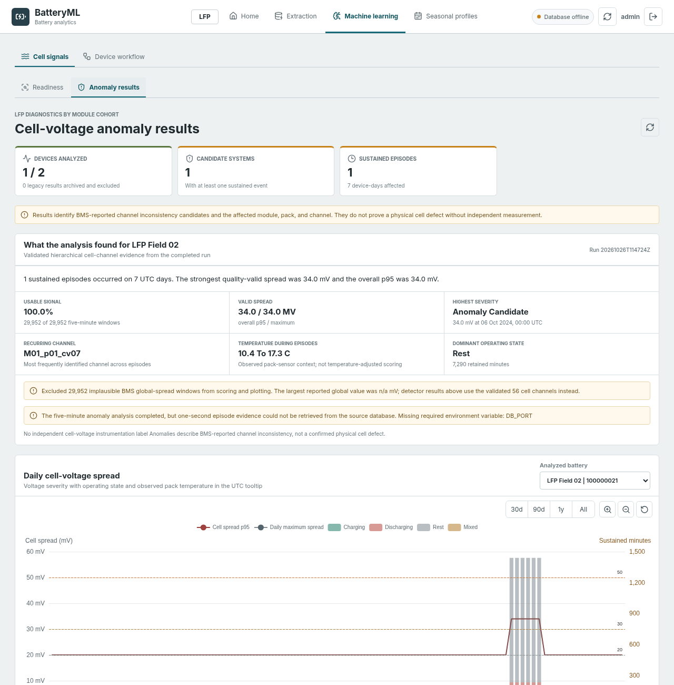
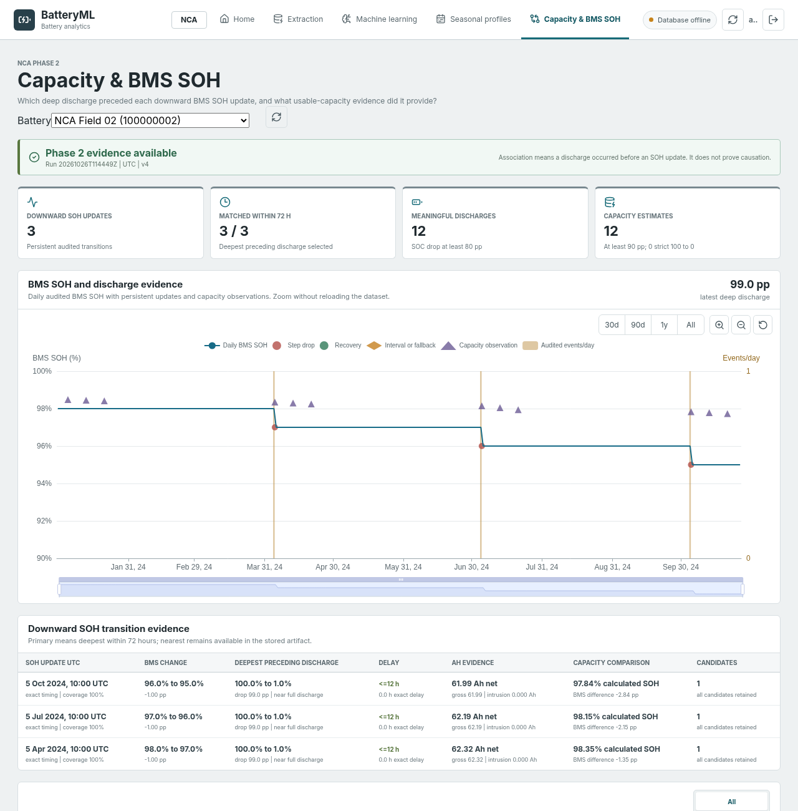
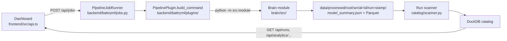

# NCA/LFP Battery Degradation ML Pipeline


[](https://github.com/veeragoutham14/nca-lfp-battery-degradation-ml-pipeline/actions)
[](https://www.python.org/)
[](https://fastapi.tiangolo.com/)
[](https://react.dev/)
[](LICENSE)

This repository is Veera Goutham Venkatesh's own pipeline from a working-student R&D project on home battery storage, published with synthetic data. One-second pack telemetry is turned into operating events, full-cycle capacity, a multi-model degradation fit, and a 10-year state-of-health forecast, then shown in a FastAPI and React dashboard. Every number and screenshot below comes from the synthetic generator.

The original real field telemetry is not included; only synthetic demo data ships with this repository.

## Capabilities

| Capability | Where it lives |
| --- | --- |
| Event segmentation of 1-second telemetry (rest, charge, discharge, missing) | `brain/src/event_segmentation.py`, `brain/src/build_events.py` |
| Capacity and SOH from exact full discharges | `brain/src/discharge_cycle_builder.py` (`build_capacity_measurements`, `build_capacity_trend_table`), `brain/src/discharge_capacity_evidence.py` |
| Degradation modelling, backtests and 10-year SOH forecast | `brain/src/capacity_ml.py` (`fit_degradation_usage_model`, `build_degradation_backtest_table`, `build_cutoff_validation_table`) |
| Fleet loss-slope check against a full-cycle reference | `brain/src/fixed_slope_verification.py`, `backend/battryml/analytics/nca_capacity_overview.py` |
| BMS SOH recalibration analysis | `brain/src/bms_soh_recalibration_analysis.py` (`build_recalibration_events`, `build_matched_control_windows`, `build_evidence_comparison`) |
| SOH gap diagnosis (BMS SOH vs capacity evidence) | `brain/src/soh_gap_diagnosis.py` (`build_reference_curve`, `build_assessments`) |
| Cell voltage anomaly detection | `brain/src/cell_voltage_anomaly.py`, `brain/src/hierarchical_voltage_anomaly.py` (pack-peer residuals, low-rank reconstruction, EWMA, episodes), `prototype_anomaly/` (Isolation Forest) |
| Electrothermal features and signal qualification | `brain/src/build_local_electrothermal_features.py`, `brain/src/bms_electrothermal_source_audit.py`, `brain/src/electrothermal_capacity_context.py` |
| Seasonal operating and charge profiles | `brain/src/seasonal_charge_analysis.py` (`build_daily_stress`, `build_monthly_profiles`, `build_transition_context`) |
| Data quality checks on raw Parquet | `brain/src/data_validation.py`, `brain/src/validate_raw_parquet.py` |
| Job API (36 routes) and pipeline plugins | `backend/battryml/api/app.py`, `backend/battryml/jobs.py`, `backend/battryml/plugins/` |
| Run catalog in DuckDB | `backend/battryml/catalog/database.py`, `backend/battryml/catalog/scanner.py` |
| Dashboard with ECharts | `frontend/src/components/`, `frontend/src/echarts.ts` |
| Tests and CI | `brain/tests/`, `backend/tests/`, `.github/workflows/ci.yml` |

## Why it's useful: one place for the whole fleet


- **One page for the NCA fleet.** The *NCA fleet capacity* tab on the Machine learning page sets every NCA field device that has a fixed-slope verification run against the full-cycle reference. It shows how many devices are active, how many sit more than 1 percentage point below the reference, the median BMS-equivalent loss slope, and how many devices lose capacity at more than twice the reference rate.
- **A bar per device.** The gap chart plots BMS SOH minus the transferred reference SOH for each device, split into within tolerance and below reference.
- **A sortable comparison table.** Modules, nominal capacity, discharge throughput, equivalent full cycles, BMS SOH, reference SOH, the difference, BMS-equivalent loss slope, and telemetry coverage, sortable by module count, reference difference, BMS SOH, throughput, or serial. Each row opens that device's workflow. Devices without a verification run are listed as pending instead of being dropped.
- **Adjustable reference.** The reference loss slope can be changed on the page and the comparison is recomputed from the stored runs.
- **Fleet-wide device library.** Every imported battery is listed per chemistry (NCA and LFP), and the *Cell signals* tab shows which cell-level sources exist per chemistry.


### Benchmark on synthetic data

`python scripts/benchmark.py --devices 30 --months 6 --workers 2` generated a 30-device fleet (1 full-cycle reference, 19 NCA field devices, 10 LFP devices) with six months of 1-second data: 38.8 million rows × 246 columns, 9.8 GB of raw Parquet. It then ran the brain on every device and timed the API with 30 warm requests per endpoint. Hardware: cloud VM with 8 vCPUs (Intel Xeon), 15.6 GB RAM, Linux, Python 3.13.

| Measure | Result |
| --- | --- |
| Brain, whole fleet, one device at a time | 479 s (median 13.4 s per device, slowest 38.7 s) |
| Brain, whole fleet, two devices in parallel | 219 s |
| Event building throughput | about 84,000 rows/s |
| Largest single brain process | 5.3 GB RSS |
| Processed output | 8.0 GB Parquet |
| `GET /api/devices` (30 devices) | first request 1.77 s, then median 53 ms, p95 60 ms |
| `GET /api/devices?refresh=true` | median 1.35 s, p95 1.47 s |
| NCA fleet comparison (19 devices) | median 81 ms, p95 85 ms (first request 88 ms) |
| Cell signal overview | median 54 ms, p95 76 ms |
| Run summary / run series | median 12 ms / 71 ms |
| Dashboard build, all files | 1.10 MB JS and CSS, 341 kB gzipped |
| Dashboard JavaScript on first page load | 268.37 kB, 79.44 kB gzipped (before code splitting: 955.54 kB, 308.01 kB gzipped) |

The first-load figure is the JavaScript that `index.html` loads before the first page renders, as reported by `npm run build` (Vite 6). Splitting React, ECharts, zrender and the icon set into separate vendor chunks and lazy-loading the Machine learning page cut it by about 72% (about 74% gzipped). ECharts now loads only when a chart page opens, and the build no longer warns about chunks over 500 kB. The total size of all files is about the same.

These are single-host numbers on synthetic data, measured with the client on the same machine. The script deletes and regenerates `brain/data/`, needs about 20 GB of free disk, and writes its full report to `var/benchmark.json`. One brain process can take several GB of RAM on six months of data, so keep `--workers` low on small machines.

## Architecture



The brain reads partitioned Parquet and writes run folders. The API catalogs those folders and can launch the same modules as jobs. The dashboard is the human interface: chemistry workspace, device library, and the charts for a completed run.

## Dashboard

Synthetic data. The API is up and the database extractor is left unconfigured, which is why the badge says database offline. The first five screenshots use the small quickstart data.


### Analysis pages on the dense demo fleet

These pages need continuous field data, so they use the optional dense devices: `100000002` (NCA, 64 Ah) and `100000021` (LFP, 50 Ah), each with 1-second data on 26 days of January, April, July and October 2024. See [Full demo fleet](#full-demo-fleet) for how to produce them.











## Results on synthetic data

The lab reference `100000017` has eight exact 100% to 0% discharges. The field device `100000001` is partial home use, with a gap longer than 60 seconds and one warm-month cell offset. `100000020` is a short LFP trace.


On the dense devices, measured from one run of the full job chain:

| Analysis | Result on `100000002` (NCA) | Result on `100000021` (LFP) |
| --- | --- | --- |
| Seasonal profile | 4 of 4 months qualified; monthly mean temperature 3.9, 12.9, 26.9 and 11.9 °C, maximum 32.4 °C | 4 of 4 months qualified, same climate |
| Cell-voltage anomaly | 1 sustained episode over 7 days in July, the planted offset | 1 sustained episode over 7 days in October, the planted offset |
| BMS SOH recalibration | 3 downward SOH steps (98 → 97 → 96 → 95 %), 15 matched control windows | 3 steps, 15 matched control windows |
| Capacity and BMS SOH | 3 of 3 SOH steps matched to the full discharge before them (within 12 h); capacity-based SOH 98.35, 98.15 and 97.84 % against BMS values of 97, 96 and 95 % | not shown on this page (NCA only) |
| SOH gap diagnosis | 3 transitions assessed, all `indeterminate`: the field device discharges to 1 % rather than 0 %, so no reference cycle of the same class matches | not run (NCA only) |

## What it does

| Piece | What you get |
| --- | --- |
| Event segmentation | Rest, charge, discharge, and missing. Rest is current inside ±0.5 A. A gap longer than 60 seconds becomes missing. |
| Full-cycle capacity | Ampere-hours from an exact 100% to 0% discharge. |
| Capacity models | Several usage and calendar models, fit with non-negative least squares, plus a 10-year forecast. |
| BMS comparison | Measured capacity SOH set next to the BMS SOH value. |
| Cell anomaly | Conditional cell-spread candidates in the brain, and an Isolation Forest prototype on pack features. |
| Seasonal profile | Monthly temperature and throughput. The full seasonal module also reads hierarchical features when those exist. |
| Dashboard | NCA and LFP workspaces, device library, job launch, and run charts. |

## Applications, extension and scaling

### What the central view is for

Every device's telemetry goes through the same brain modules and ends up in one DuckDB catalog. The dashboard can then put devices next to each other instead of opening one analysis per device. In the synthetic benchmark that meant 30 devices, 38.8 million rows and 9.8 GB of raw Parquet, processed in 479 s one device at a time (median 13.4 s per device). After that, the 19-device NCA comparison answers in a median of 81 ms and the device list in 53 ms.

The design supports these uses:

| Use | What the pipeline provides |
| --- | --- |
| Fleet health monitoring | One device library per chemistry, the NCA fleet capacity page, and per-device run charts for SOH, capacity, anomalies, electrothermal and seasonal results |
| Warranty and SOH checks | Capacity SOH from exact full discharges set against the BMS SOH value, the SOH gap diagnosis, and the 10-year forecast with its 80% SOH line |
| NCA vs LFP comparison | Chemistry is part of each battery profile (`config/battery_profiles.json`), and plugins can be limited to one chemistry |
| Field vs lab cycles | Field devices are compared with a full-cycle reference through an adjustable reference loss slope |
| Early anomaly detection | Cell-spread candidates, hierarchical voltage anomaly episodes, and the Isolation Forest prototype flag cell-level voltage deviations per device, separate from the pack capacity trend |

These are uses the code is built for. Every result in this repository comes from synthetic data.

### How a job flows through the code



Each brain module is a normal command-line program with `build_parser()` and `main()`. A backend plugin only describes the module: its key, parameters, allowed device roles and chemistries, the stages it depends on, and the command to run. `PipelineJobRunner.submit` validates the parameters, refuses a second active job for the same device, and runs the command in a detached worker process (`backend/battryml/job_worker.py`). When the module writes a run folder with a `model_summary.json`, `LegacyRunScanner` picks it up through its `RUN_FAMILIES` entry and records the run, its artifacts and its datasets in DuckDB.

### Adding a new analytics feature

Example: a hypothetical daily charge-efficiency trend per device.

1. **Brain module.** Add `brain/src/charge_efficiency.py` with `build_parser()` and `main()`. Read the event tables that `build_events.py` writes, compute the daily values with pandas, and write `data/processed/charge_efficiency/serial=<id>/efficiency_run=<stamp>/` containing a Parquet table and `model_summary.json`. Add tests in `brain/tests/`.
2. **Plugin.** Add a `PipelinePlugin` subclass in `backend/battryml/plugins/` with `key`, `name`, `output_family`, `workflow_stage`, `requires_stage` (the stage it depends on) and a `parameters` tuple of `ParameterDefinition`. Its `build_command` returns `(settings.source_python, "-m", "src.charge_efficiency", "--serial", ...)`. Register it in `build_default_registry()` in `plugins/registry.py`. It then appears in `GET /api/pipelines` and can be started with `POST /api/jobs`.
3. **Catalog.** Add a `RunFamily` to `RUN_FAMILIES` in `catalog/scanner.py` with the root name, run prefix, and which files are history, forecast or validation. The generic `/api/runs/{run_id}/summary`, `/series` and `/artifacts` routes then serve the new run without a new route.
4. **Fleet view (optional).** For a cross-device view, add a builder in `backend/battryml/analytics/`, following `nca_capacity_overview.py`, and expose it with an `@app.get("/api/analytics/...")` route in `api/app.py`.
5. **Dashboard.** Add a method to the `api` object in `frontend/src/api.ts` and a component that renders `ReactEChartsCore` with the shared `echarts` instance from `frontend/src/echarts.ts`, registering any extra chart type there. Load a new page with `lazy()` in `App.tsx` so it stays out of the first-load bundle, or add it as a tab on the Machine learning page.
6. **Tests.** Cover the plugin and route in `backend/tests/` (see `test_plugins.py` and `test_api.py`). CI runs them with ruff and the scan.

**New signals.** Raw input is Parquet in `brain/data/raw_parquet/serial=<id>/year=YYYY/month=MM/`. The core signal names are set in `SignalColumnConfig` in `brain/src/config.py` and can be remapped with environment variables such as `CURRENT_COL` and `SOC_COL`, together with the rest threshold and the gap threshold. Extra per-module, per-sensor and system signals are described in `config/signal_catalog.json` and `config/telemetry_import_profiles.json`.

**Other data sources.** Extraction is a separate first step. `brain/src/extract_db.py` and `brain/src/extract_configurable_telemetry.py` read from an optional PostgreSQL source into that layout, and `scripts/generate_synthetic_telemetry.py` writes the same layout from a generator. Any source that writes that partition layout with the configured columns can replace them. `brain/src/validate_raw_parquet.py` and the data validation plugin check the result before analysis.

### Scaling

| Already in the code | Measured or configured |
| --- | --- |
| Parquet partitioned by `serial`, `year` and `month` | A device run reads only its own `serial=<id>` folder, and month folders keep files small |
| Independent per-device runs | 30 devices: 479 s sequential, 219 s with two parallel workers (`scripts/benchmark.py --workers 2`) |
| Separate thread pools for extraction and analysis jobs | `BATTRYML_WORKER_THREADS` (default 2) and `BATTRYML_ML_WORKER_THREADS` (default 1) |
| DuckDB catalog with indexes on serial and run time | Fleet comparison over 19 devices: median 81 ms |

Possible next steps, not implemented here:

- A shared job queue, for example a message broker, so jobs can run on several hosts. Today the runner keeps jobs in the DuckDB catalog and recovers unfinished ones on restart (`recover_incomplete_jobs`), but runs them on one host.
- More workers per host, limited by memory: the largest single brain process used 5.3 GB on six months of data.
- Object storage for the Parquet partitions, read by DuckDB or PyArrow.
- Incremental runs that only process new months for each device.

## Synthetic data and sources

`scripts/generate_synthetic_telemetry.py` writes every file the demo uses. No measured data is copied into this repository. Only published parameters were taken from these open datasets and papers:

| Source | Licence | Used for |
| --- | --- | --- |
| Severson et al., "Data-driven prediction of battery cycle life before capacity degradation", *Nature Energy* 4, 383–391 (2019) | CC BY 4.0 | LFP voltage window, range of cycle lives to 80 % capacity |
| Preger et al., "Degradation of commercial lithium-ion cells as a function of chemistry and cycling conditions", *J. Electrochem. Soc.* 167, 120532 (2020), data via [Battery Archive](https://www.batteryarchive.org/) | CC BY 4.0 | NCA and LFP voltage windows and nominal voltages, faster fade of NCA than LFP |
| NASA Prognostics Center of Excellence, Li-ion battery aging data set (Saha and Goebel, 2007) | US government work | Shape of capacity fade over cycles |
| Wang et al., "Cycle-life model for graphite-LiFePO4 cells", *J. Power Sources* 196, 3942–3948 (2011) | paper | Arrhenius activation energy of 31.5 kJ/mol for temperature-dependent fade |

Seasonal ambient temperatures follow a generic Central European climate. The generator is deterministic: the same command writes the same files.

## Tech stack

| Layer | Tools |
| --- | --- |
| Analysis | Python 3.12, pandas, NumPy, PyArrow, DuckDB, scikit-learn, matplotlib |
| API | FastAPI, Uvicorn, DuckDB job catalog |
| Dashboard | React 19, TypeScript, Vite, ECharts |
| Data | Partitioned Parquet. PostgreSQL is optional and unused in the demo. |

## Quickstart

```bash
python3 -m venv .venv
source .venv/bin/activate
pip install -r brain/requirements.txt
pip install -e ".[dev]"
cd frontend && npm ci && cd ..
./scripts/demo.sh
```

The demo generates synthetic telemetry, builds events and the capacity forecast, and opens the dashboard at [http://127.0.0.1:5173](http://127.0.0.1:5173). The API listens on [http://127.0.0.1:8000](http://127.0.0.1:8000).

Copy `.env.example` if you want to point the optional extractor at your own database. Leave the host, name, user, and password empty for the synthetic demo. Authentication is off in that demo so the dashboard opens directly. Started any other way, the API asks for a login (`admin` / `battryml` by default) unless `BATTRYML_AUTH_ENABLED=false` is set.

### Full demo fleet

The quickstart keeps the data small. The seasonal, recalibration, anomaly and SOH gap pages need the two dense field devices, which add about 18 million rows (about 1.3 GB of Parquet):

```bash
python scripts/generate_synthetic_telemetry.py --dense-field-device
```

Then run the stages for each device from *Machine learning → Device workflow* in the dashboard, top to bottom. The same chain through the job API, in a temporary directory, is the end-to-end test:

```bash
python -m pytest -m slow backend/tests/test_e2e_demo_chain.py
```

It generates the fleet, runs 28 jobs (classification, events, analysis-data preparation, anomaly detection, SOH signal audit, discharge evidence, BMS SOH recalibration, capacity and SOH investigation, seasonal profile, and the SOH gap diagnosis) and checks their results. On an 8-vCPU VM with 15.6 GB RAM it takes about 8 minutes (481 s measured), so it is excluded from the default test run and from CI.

## Project structure

```text
brain/                  SOH engine: events, cycles, capacity models, forecasts
backend/battryml/       FastAPI app, job runner, DuckDB catalog
frontend/               React dashboard
prototype_anomaly/      Early Isolation Forest prototype
config/                 Synthetic device profiles and the signal catalog
scripts/                Synthetic generator, one-command demo, fleet benchmark, secret scan
docs/images/            Figures in this README
```

## Tests

GitHub Actions runs five checks. The ruff lint, the brain tests, the platform suite, and the forbidden-string scan run on Python 3.12 and 3.13. The frontend production build is a separate job.

- `ruff check .` (rules and scoped ignores in `pyproject.toml`)
- 98 brain tests (`cd brain && python -m pytest`)
- the platform suite (`python -m pytest`; the slow end-to-end test is opt-in, see [Full demo fleet](#full-demo-fleet))
- the frontend production build (`cd frontend && npm ci && npm run build`)
- `python scripts/scan_forbidden.py`

`./scripts/demo.sh` writes fresh plots to `docs/images/generated/`, which is gitignored. The pictures in this README are the committed copies.

## License

All rights reserved. See [LICENSE](LICENSE). This source is published for viewing and evaluation only.
