# NCA/LFP Battery Degradation ML Pipeline


[](https://github.com/veeragoutham14/nca-lfp-battery-degradation-ml-pipeline/actions)
[](https://www.python.org/)
[](https://fastapi.tiangolo.com/)
[](https://react.dev/)
[](LICENSE)

This repository is Veera Goutham Venkatesh's own pipeline from a working-student R&D project on home battery storage, published with synthetic data. One-second pack telemetry is turned into operating events, full-cycle capacity, a multi-model degradation fit, and a 10-year state-of-health forecast, then shown in a FastAPI and React dashboard. Every number and screenshot below comes from the synthetic generator.

## Capabilities

| Capability | Where it lives |
| --- | --- |
| Event segmentation of 1-second telemetry (rest, charge, discharge, missing) | `brain/src/event_segmentation.py`, `brain/src/build_events.py` |
| Capacity and SOH from exact full discharges | `brain/src/discharge_cycle_builder.py` (`build_capacity_measurements`, `build_capacity_trend_table`), `brain/src/discharge_capacity_evidence.py` |
| Degradation modelling, backtests and 10-year SOH forecast | `brain/src/capacity_ml.py` (`fit_degradation_usage_model`, `build_degradation_backtest_table`, `build_cutoff_validation_table`) |
| Fleet loss-slope check against a full-cycle reference | `brain/src/fixed_slope_verification.py`, `backend/battryml/analytics/nca_capacity_overview.py` |
| BMS SOH recalibration analysis | `brain/src/bms_soh_recalibration_analysis.py` (`build_recalibration_events`, `build_matched_control_windows`, `build_evidence_comparison`) |
| SOH gap diagnosis (BMS SOH vs capacity evidence) | `brain/src/soh_gap_diagnosis.py` (`build_reference_curve`, `build_assessments`) |
| Cell voltage anomaly detection | `brain/src/cell_voltage_anomaly.py`, `brain/src/hierarchical_voltage_anomaly.py` (pack-peer residuals, low-rank reconstruction, EWMA, episodes), `prototype_anomaly/` (Isolation Forest) |
| Electrothermal features and signal qualification | `brain/src/build_local_electrothermal_features.py`, `brain/src/bms_electrothermal_source_audit.py`, `brain/src/electrothermal_capacity_context.py` |
| Seasonal operating and charge profiles | `brain/src/seasonal_charge_analysis.py` (`build_daily_stress`, `build_monthly_profiles`, `build_transition_context`) |
| Data quality checks on raw Parquet | `brain/src/data_validation.py`, `brain/src/validate_raw_parquet.py` |
| Job API (36 routes) and pipeline plugins | `backend/battryml/api/app.py`, `backend/battryml/jobs.py`, `backend/battryml/plugins/` |
| Run catalog in DuckDB | `backend/battryml/catalog/database.py`, `backend/battryml/catalog/scanner.py` |
| Dashboard with ECharts | `frontend/src/components/`, `frontend/src/echarts.ts` |
| Tests and CI | `brain/tests/`, `backend/tests/`, `.github/workflows/ci.yml` |

## Why it's useful: one place for the whole fleet

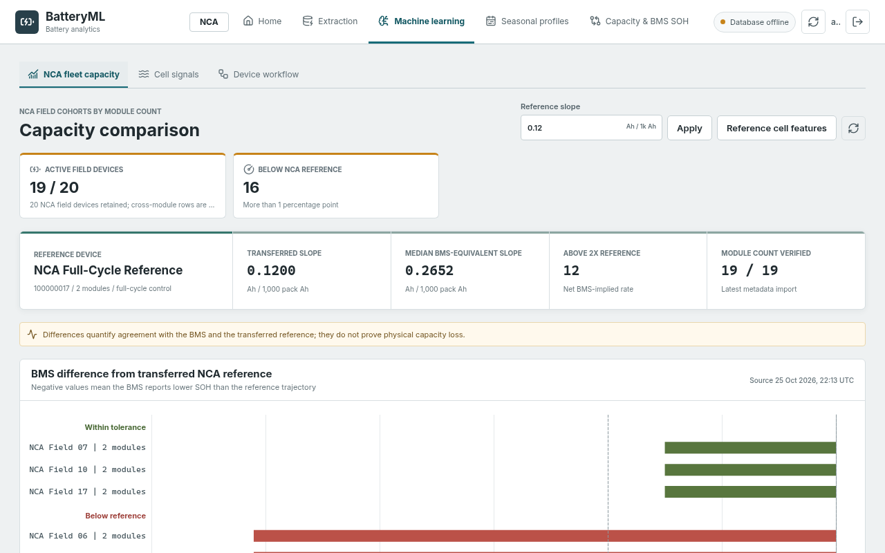

- **One page for the NCA fleet.** The *NCA fleet capacity* tab on the Machine learning page sets every NCA field device that has a fixed-slope verification run against the full-cycle reference. It shows how many devices are active, how many sit more than 1 percentage point below the reference, the median BMS-equivalent loss slope, and how many devices lose capacity at more than twice the reference rate.
- **A bar per device.** The gap chart plots BMS SOH minus the transferred reference SOH for each device, split into within tolerance and below reference.
- **A sortable comparison table.** Modules, nominal capacity, discharge throughput, equivalent full cycles, BMS SOH, reference SOH, the difference, BMS-equivalent loss slope, and telemetry coverage, sortable by module count, reference difference, BMS SOH, throughput, or serial. Each row opens that device's workflow. Devices without a verification run are listed as pending instead of being dropped.
- **Adjustable reference.** The reference loss slope can be changed on the page and the comparison is recomputed from the stored runs.
- **Fleet-wide device library.** Every imported battery is listed per chemistry (NCA and LFP), and the *Cell signals* tab shows which cell-level sources exist per chemistry.

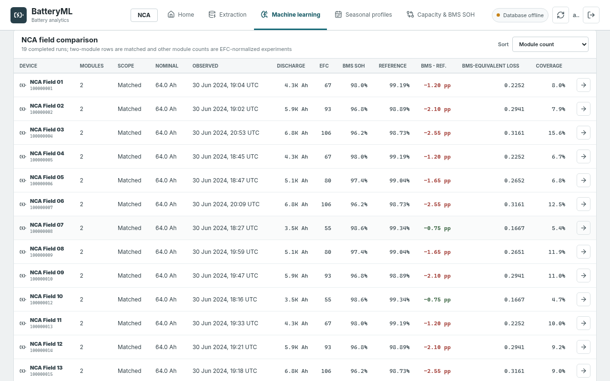

### Benchmark on synthetic data

`python scripts/benchmark.py --devices 30 --months 6 --workers 2` generated a 30-device fleet (1 full-cycle reference, 19 NCA field devices, 10 LFP devices) with six months of 1-second data: 38.8 million rows × 246 columns, 9.8 GB of raw Parquet. It then ran the brain on every device and timed the API with 30 warm requests per endpoint. Hardware: cloud VM with 8 vCPUs (Intel Xeon), 15.6 GB RAM, Linux, Python 3.13.

| Measure | Result |
| --- | --- |
| Brain, whole fleet, one device at a time | 479 s (median 13.4 s per device, slowest 38.7 s) |
| Brain, whole fleet, two devices in parallel | 219 s |
| Event building throughput | about 84,000 rows/s |
| Largest single brain process | 5.3 GB RSS |
| Processed output | 8.0 GB Parquet |
| `GET /api/devices` (30 devices) | first request 1.77 s, then median 53 ms, p95 60 ms |
| `GET /api/devices?refresh=true` | median 1.35 s, p95 1.47 s |
| NCA fleet comparison (19 devices) | median 81 ms, p95 85 ms (first request 88 ms) |
| Cell signal overview | median 54 ms, p95 76 ms |
| Run summary / run series | median 12 ms / 71 ms |
| Dashboard build, all files | 1.10 MB JS and CSS, 341 kB gzipped |
| Dashboard JavaScript on first page load | 268.37 kB, 79.44 kB gzipped (before code splitting: 955.54 kB, 308.01 kB gzipped) |

The first-load figure is the JavaScript that `index.html` loads before the first page renders, as reported by `npm run build` (Vite 6). Splitting React, ECharts, zrender and the icon set into separate vendor chunks and lazy-loading the Machine learning page cut it by about 72% (about 74% gzipped). ECharts now loads only when a chart page opens, and the build no longer warns about chunks over 500 kB. The total size of all files is about the same.

These are single-host numbers on synthetic data, measured with the client on the same machine. The script deletes and regenerates `brain/data/`, needs about 20 GB of free disk, and writes its full report to `var/benchmark.json`. One brain process can take several GB of RAM on six months of data, so keep `--workers` low on small machines.

## Architecture

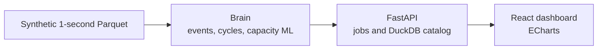

The brain reads partitioned Parquet and writes run folders. The API catalogs those folders and can launch the same modules as jobs. The dashboard is the human interface: chemistry workspace, device library, and the charts for a completed run.

## Dashboard

Synthetic data. The API is up and the database extractor is left unconfigured, which is why the badge says database offline.

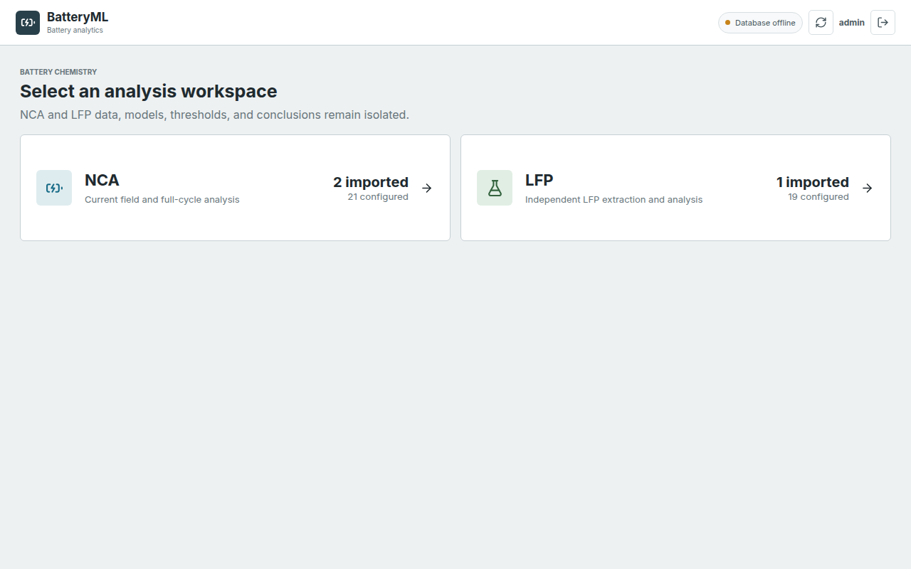

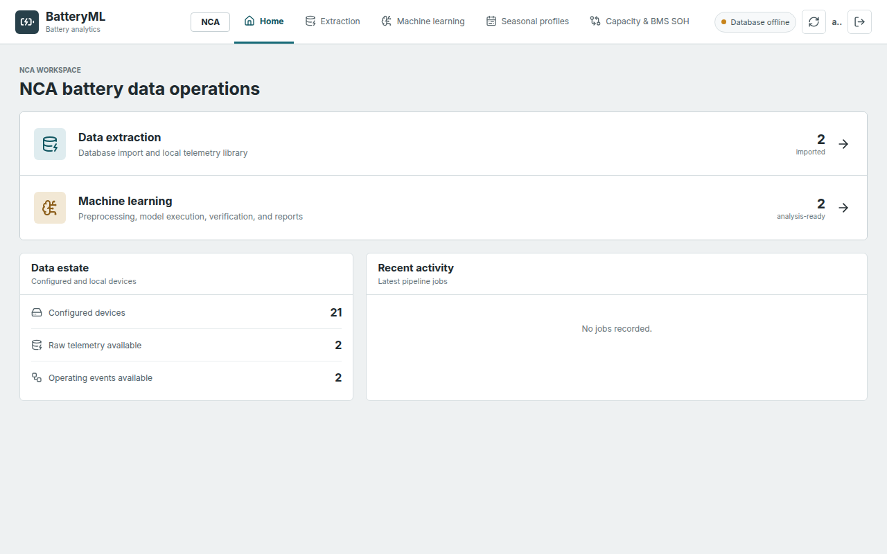

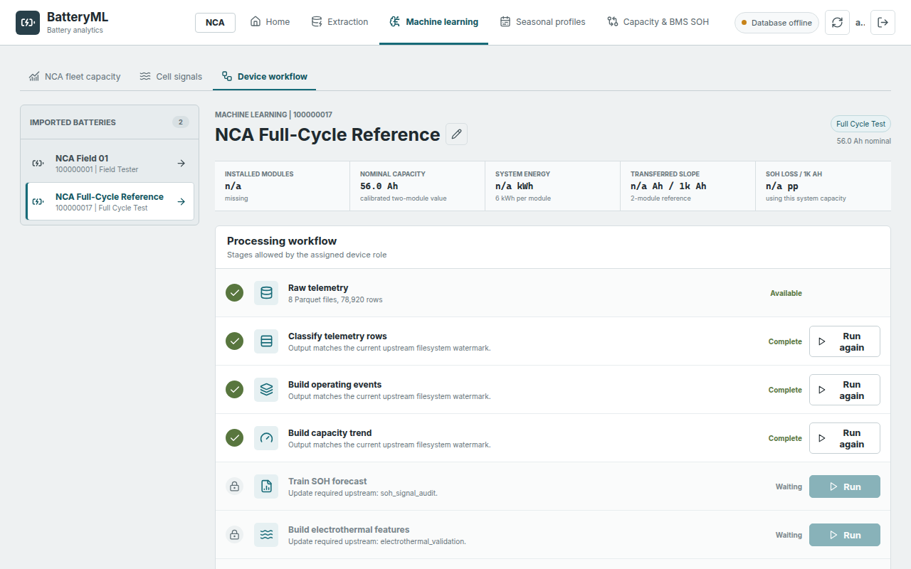

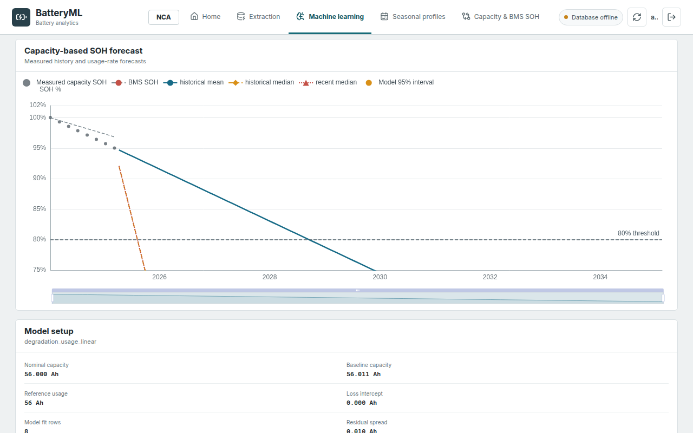

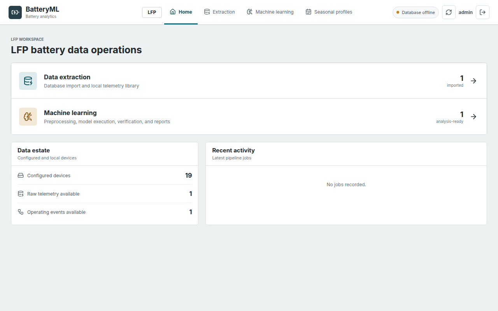

## Results on synthetic data

The lab reference `100000017` has eight exact 100% to 0% discharges. The field device `100000001` is partial home use, with a gap longer than 60 seconds and one warm-month cell offset. `100000020` is a short LFP trace.

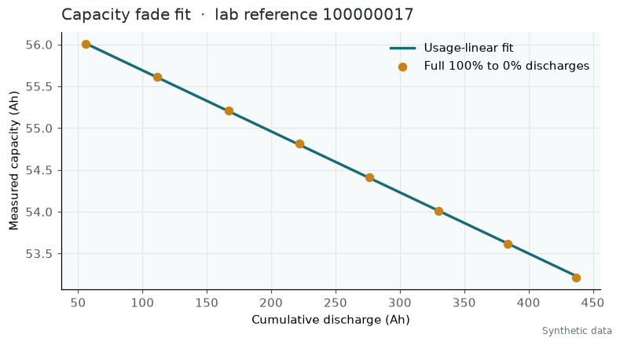

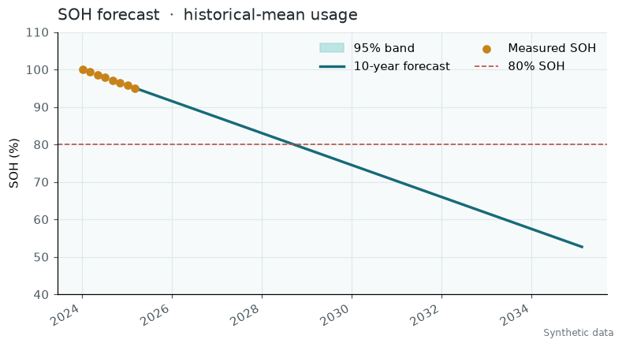

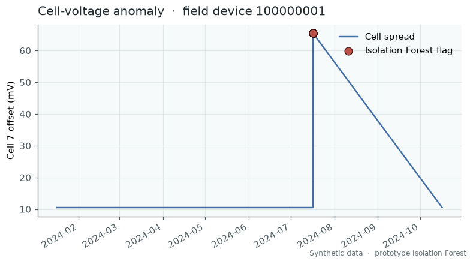

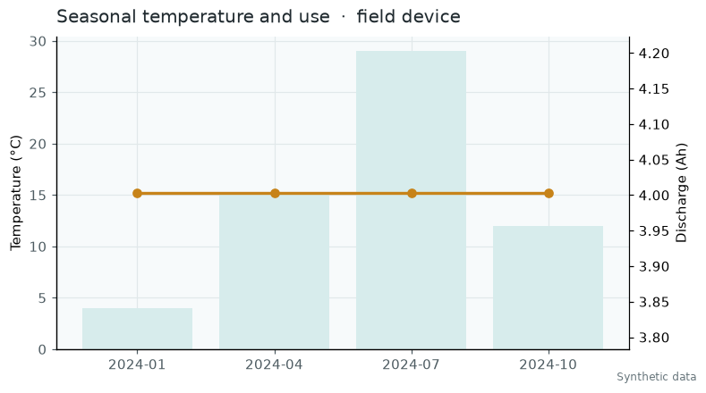

## What it does

| Piece | What you get |
| --- | --- |
| Event segmentation | Rest, charge, discharge, and missing. Rest is current inside ±0.5 A. A gap longer than 60 seconds becomes missing. |
| Full-cycle capacity | Ampere-hours from an exact 100% to 0% discharge. |
| Capacity models | Several usage and calendar models, fit with non-negative least squares, plus a 10-year forecast. |
| BMS comparison | Measured capacity SOH set next to the BMS SOH value. |
| Cell anomaly | Conditional cell-spread candidates in the brain, and an Isolation Forest prototype on pack features. |
| Seasonal profile | Monthly temperature and throughput. The full seasonal module also reads hierarchical features when those exist. |
| Dashboard | NCA and LFP workspaces, device library, job launch, and run charts. |

## Tech stack

| Layer | Tools |
| --- | --- |
| Analysis | Python 3.12, pandas, NumPy, PyArrow, DuckDB, scikit-learn, matplotlib |
| API | FastAPI, Uvicorn, DuckDB job catalog |
| Dashboard | React 19, TypeScript, Vite, ECharts |
| Data | Partitioned Parquet. PostgreSQL is optional and unused in the demo. |

## Quickstart

```bash
python3 -m venv .venv
source .venv/bin/activate
pip install -r brain/requirements.txt
pip install -e ".[dev]"
cd frontend && npm ci && cd ..
./scripts/demo.sh
```

The demo generates synthetic telemetry, builds events and the capacity forecast, and opens the dashboard at [http://127.0.0.1:5173](http://127.0.0.1:5173). The API listens on [http://127.0.0.1:8000](http://127.0.0.1:8000).

Copy `.env.example` if you want to point the optional extractor at your own database. Leave the host, name, user, and password empty for the synthetic demo. Authentication is off in that demo so the dashboard opens directly.

## Project structure

```text
brain/                  SOH engine: events, cycles, capacity models, forecasts
backend/battryml/       FastAPI app, job runner, DuckDB catalog
frontend/               React dashboard
prototype_anomaly/      Early Isolation Forest prototype
config/                 Synthetic device profiles and the signal catalog
scripts/                Synthetic generator, one-command demo, fleet benchmark, secret scan
docs/images/            Figures in this README
```

## Tests

GitHub Actions runs five checks. The ruff lint, the brain tests, the platform suite, and the forbidden-string scan run on Python 3.12 and 3.13. The frontend production build is a separate job.

- `ruff check .` (rules and scoped ignores in `pyproject.toml`)
- 89 brain tests (`cd brain && python -m pytest`)
- the platform suite (`python -m pytest`)
- the frontend production build (`cd frontend && npm ci && npm run build`)
- `python scripts/scan_forbidden.py`

`./scripts/demo.sh` writes fresh plots to `docs/images/generated/`, which is gitignored. The pictures in this README are the committed copies.

## License

All rights reserved. See [LICENSE](LICENSE). This source is published for viewing and evaluation only.
