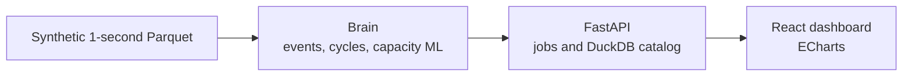

# NCA/LFP Battery Degradation ML Pipeline


[](https://github.com/veeragoutham14/nca-lfp-battery-degradation-ml-pipeline/actions)
[](https://www.python.org/)
[](https://fastapi.tiangolo.com/)
[](https://react.dev/)
[](LICENSE)

This repository is Veera Goutham Venkatesh's own pipeline from a working-student R&D project on home battery storage, published with synthetic data. One-second pack telemetry is turned into operating events, full-cycle capacity, a multi-model degradation fit, and a 10-year state-of-health forecast, then shown in a FastAPI and React dashboard. Every number and screenshot below comes from the synthetic generator.

## Architecture



The brain reads partitioned Parquet and writes run folders. The API catalogs those folders and can launch the same modules as jobs. The dashboard is the human interface: chemistry workspace, device library, and the charts for a completed run.

## Dashboard

Synthetic data. The API is up and the database extractor is left unconfigured, which is why the badge says database offline.


## Results on synthetic data

The lab reference `100000017` has eight exact 100% to 0% discharges. The field device `100000001` is partial home use, with a gap longer than 60 seconds and one warm-month cell offset. `100000020` is a short LFP trace.


## What it does

| Piece | What you get |
| --- | --- |
| Event segmentation | Rest, charge, discharge, and missing. Rest is current inside ±0.5 A. A gap longer than 60 seconds becomes missing. |
| Full-cycle capacity | Ampere-hours from an exact 100% to 0% discharge. |
| Capacity models | Several usage and calendar models, fit with non-negative least squares, plus a 10-year forecast. |
| BMS comparison | Measured capacity SOH set next to the BMS SOH value. |
| Cell anomaly | Conditional cell-spread candidates in the brain, and an Isolation Forest prototype on pack features. |
| Seasonal profile | Monthly temperature and throughput. The full seasonal module also reads hierarchical features when those exist. |
| Dashboard | NCA and LFP workspaces, device library, job launch, and run charts. |

## Tech stack

| Layer | Tools |
| --- | --- |
| Analysis | Python 3.12, pandas, NumPy, PyArrow, DuckDB, scikit-learn, matplotlib |
| API | FastAPI, Uvicorn, DuckDB job catalog |
| Dashboard | React 19, TypeScript, Vite, ECharts |
| Data | Partitioned Parquet. PostgreSQL is optional and unused in the demo. |

## Quickstart

```bash
python3 -m venv .venv
source .venv/bin/activate
pip install -r brain/requirements.txt
pip install -e ".[dev]"
cd frontend && npm ci && cd ..
./scripts/demo.sh
```

The demo generates synthetic telemetry, builds events and the capacity forecast, and opens the dashboard at [http://127.0.0.1:5173](http://127.0.0.1:5173). The API listens on [http://127.0.0.1:8000](http://127.0.0.1:8000).

Copy `.env.example` if you want to point the optional extractor at your own database. Leave the host, name, user, and password empty for the synthetic demo. Authentication is off in that demo so the dashboard opens directly.

## Project structure

```text
brain/                  SOH engine: events, cycles, capacity models, forecasts
backend/battryml/       FastAPI app, job runner, DuckDB catalog
frontend/               React dashboard
prototype_anomaly/      Early Isolation Forest prototype
config/                 Synthetic device profiles and the signal catalog
scripts/                Synthetic generator, one-command demo, secret scan
docs/images/            Figures in this README
```

## Tests

GitHub Actions runs four checks. The brain tests, the platform suite, and the forbidden-string scan run on Python 3.12 and 3.13. The frontend production build is a separate job.

- 89 brain tests (`cd brain && python -m pytest`)
- the platform suite (`python -m pytest`)
- the frontend production build (`cd frontend && npm ci && npm run build`)
- `python scripts/scan_forbidden.py`

`./scripts/demo.sh` writes fresh plots to `docs/images/generated/`, which is gitignored. The pictures in this README are the committed copies.

## License

All rights reserved. See [LICENSE](LICENSE). This source is published for viewing and evaluation only.
